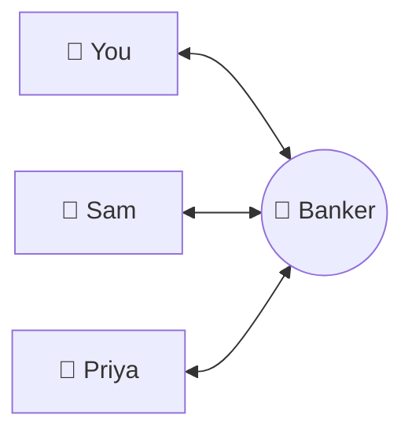
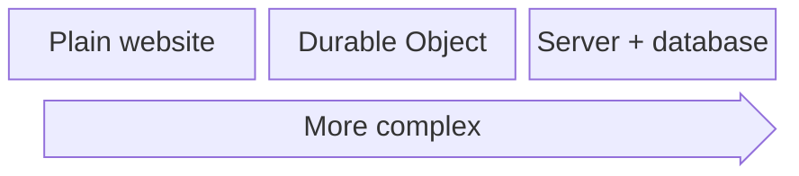

> AI builders reach for a database when they only need a whiteboard.

You've built a great game, and now you want to play it online with your friends. To do
that you need a backend, and there's a cheap, easy way to get one.

## Why you need a backend

Think of the banker in Monopoly. When you buy Park Lane, you pay the banker, and everyone
sees it. Nobody argues about who has what, because the banker's word is final.

Your game needs a banker too. Each phone runs its own copy of the game and can't see the
others. Something has to hold the one true version of the game and tell every phone when
it changes. That's your backend.

## Your AI will probably reach for a database

Ask an AI agent for a backend and it will often suggest a server and a database. Those
are built to remember things forever, like user accounts and orders. Your game only needs
to remember one evening, so you'd be paying for, and looking after, far more than you need.

## The happy middle ground: Durable Objects

[Cloudflare Durable Objects](https://developers.cloudflare.com/durable-objects/concepts/what-are-durable-objects/)
sit between a plain website and a full server. Each game lobby gets its own one, and it
acts as the banker:

- It's created when someone starts a game.
- Every phone connects to it and sees changes instantly.
- It sleeps, and costs nothing, when nobody's playing.
- It can delete itself once the game is over.

## It's almost certainly free

Cloudflare's [free plan](https://developers.cloudflare.com/durable-objects/platform/pricing/)
covers 100,000 requests a day. A game with friends won't come close, and if yours ever
does, people love your game.

## What it's good for (and what it isn't)

| Great fit 👍 | Use a real database 👎 |
| --- | --- |
| Game lobbies | User accounts and logins |
| Live quizzes and polls | Anything you need next year |
| Chat rooms and waiting rooms | Searching across all your users |
| Shared whiteboards and to-do lists for a session | Payments and orders |

The rule of thumb: if the data belongs to **one group, for a while**, a Durable Object
is probably a good fit.

## See one in action

I built [[projects/turntimer|TurnTimer]], a chess clock for board games where every
player runs the clock from their own phone. Each lobby is its own Durable Object, and it
costs me nothing to run. Try it: [timer.deanw.dev](https://timer.deanw.dev/)

## Ask your AI

Next time you're vibing with Claude, ask it:

> Is a Durable Object a good call for this? Explain why or why not in plain English.
> Don't write any code yet.
